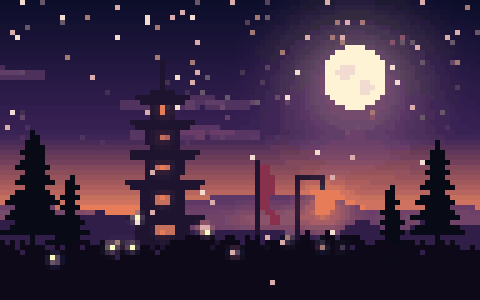
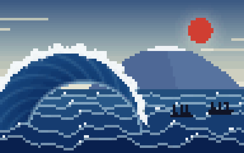
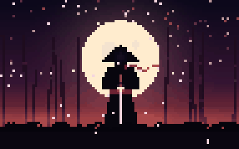
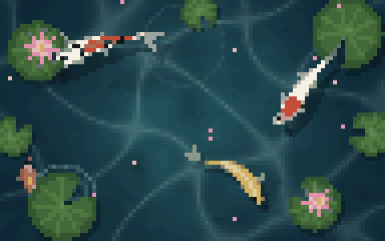
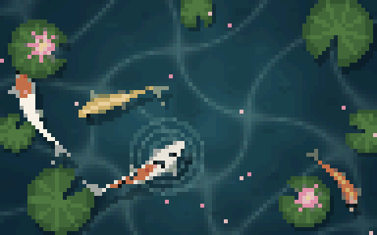
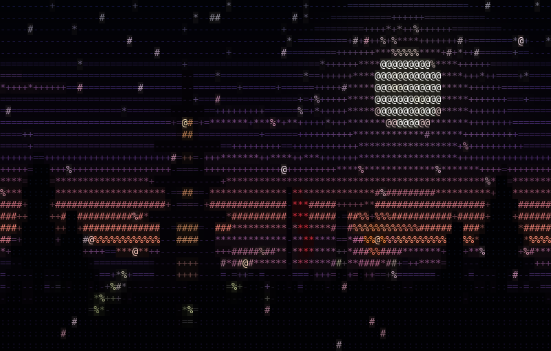
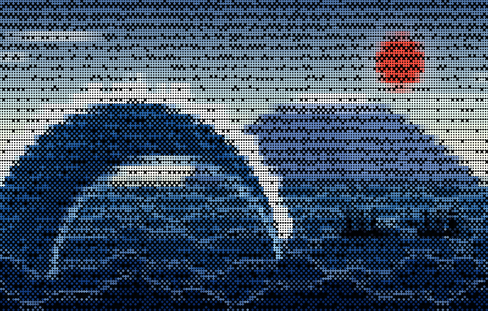
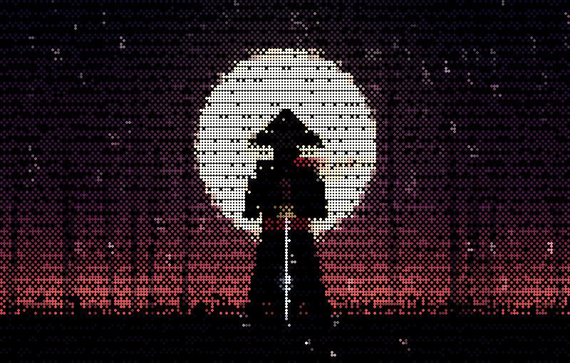

# jrice: Japan rice pack

Animated Japanese scenes for your terminal, written in Rust. Run one in a spare pane, a scratchpad or a terminal wallpaper setup, and rice your desktop with it.

| Temple | Wave |
|---|---|
|  |  |
| **Samurai** | **Koi** |
|  |  |

- **temple**: a pagoda at dusk. Pines and grass sway, a window flickers, a lantern swings, a banner flutters, fireflies drift and petals blow past.
- **wave**: a great wave curling over the sea in the spirit of ukiyo-e prints, with foam claws, Mount Fuji and fishing boats riding the swell.
- **samurai**: a ronin under a huge moon, both hands on a katana planted in the ground. He breathes slowly while his sleeves and scarf move in the wind.
- **koi**: a pond seen from above. Four koi (Kohaku, Sanke, gold Ogon and an orange one) glide through it with swaying bodies and flapping fins, casting shadows on the floor. Light caustics ripple over the bottom, rings spread where a fish touches the surface, and lily pads with lotus flowers drift on top.

All scenes are drawn in code with shapes, so there are no image assets to load and they fit any terminal size.

## Fixed colours or your theme

Every scene has its own fixed colours by default. Add `--sync` and it takes on your terminal's colour theme instead:



*The koi pond in its own colours, then Catppuccin Mocha, Gruvbox Dark and Rosé Pine.*

```bash
jrice koi --sync                    # ask the terminal for its colours
jrice koi --theme gruvbox-dark      # a built-in theme
jrice koi --theme ~/.config/kitty/current-theme.conf   # a kitty theme file
jrice --themes                      # list the built-in themes
```

- **`--sync`** asks the terminal for its background, foreground and 16 palette colours, and asks again every couple of seconds, so switching your terminal theme recolours a running scene. kitty, foot, WezTerm, Alacritty, Ghostty and most modern terminals answer. Inside tmux or screen the question usually doesn't get through; then `jrice` keeps its fixed colours and tells you so when you quit.
- **`--theme`** takes a built-in name (kanagawa, catppuccin-mocha, gruvbox-dark, tokyo-night, nord, rose-pine) or a kitty theme file. A file is reloaded when it changes, so it follows `kitten themes` too.
- **`t`** switches between fixed and theme colours while it runs.
- `jrice --info` tells you whether your terminal reports its colours.

The koi pond builds its colours from the theme directly: water from the blues and cyans, koi from the reds, yellows and foreground, lily pads from the greens, lotus from the magentas. The other scenes are painted in their fixed colours and then mapped onto the theme: dark areas become the theme background, bright areas its foreground, and coloured areas move to the theme colour with the nearest hue. Because dark areas land exactly on the background, the scene blends into the terminal's edges. Themes are designed for dark backgrounds; on a light theme the scenes come out inverted.

## Three looks for every scene

Every scene works in all three render modes. Press `a` while it runs to cycle, or pick one with `--mode`.

| `blocks` (default) | `ascii` | `dots` |
|---|---|---|
| Painted look, two pixels per cell using half blocks. | Classic ASCII art: characters picked by brightness, tinted with the scene's colours. | Dot-matrix halftone art made of braille dots, eight per cell. |

| ascii (`jrice temple --mode ascii`) | dots (`jrice wave --mode dots`) | dots (`jrice samurai --mode dots`) |
|---|---|---|
|  |  |  |

The `dots` mode needs a font with braille glyphs. Most programming fonts and Nerd Fonts have them.

## Install

You need a terminal with truecolor (24-bit colour) support and a recent stable Rust.

```bash
git clone https://github.com/Minior4eto/japan-rice
cd japan-rice
cargo install --path .
```

Or just build it: `cargo build --release`, then run `./target/release/jrice`.

On Arch: `sudo pacman -S rust` (or install `rustup`), then the steps above.

## Usage

```bash
jrice                 # temple (default)
jrice wave
jrice koi --sync             # match your terminal theme
jrice samurai --mode ascii   # or --ascii
jrice wave --mode dots       # or --dots
jrice temple --fps 30 --speed 0.7
jrice --list
```

Keys while running:

| Key | Action |
|---|---|
| `1` `2` `3` `4` or `←` `→` | switch scene |
| `a` | cycle blocks / ascii / dots |
| `t` | toggle fixed / theme colours |
| `q`, `Esc`, `Ctrl-C` | quit |

## Fullscreen and the border

If a thin border stays visible when you fullscreen the terminal, it is not drawn by `jrice`. A program inside a terminal can only paint the character grid, so these show through:

- **Leftover pixels.** The window size is rarely an exact multiple of the cell size, so a strip of a few pixels remains on the right and bottom.
- **Terminal padding.** Most terminals add padding around the grid. Examples: Alacritty `window.padding = { x = 0, y = 0 }` (and `dynamic_padding = false`), kitty `window_padding_width 0`, foot `pad=0x0`.
- **Window manager gaps and borders** that stay on in fullscreen. Check your window manager's fullscreen setting.

Two things in `jrice` help:

```bash
jrice --info          # prints grid size, window pixels and cell size, to see how big the leftover margin is
jrice temple --match-bg   # sets the terminal's own background to the scene's bottom-edge colour while running
```

`--match-bg` makes the leftover strip blend in with the scene. It uses an escape sequence (OSC 11) that most modern terminals support, and `jrice` restores your original background when it exits.

## How it works

Each scene is a pure function of time that paints a small canvas of square pixels. The renderer then turns that canvas into terminal cells in one of three ways. `blocks` packs two pixels into one cell with the `▀` half block (foreground colour for the top pixel, background for the bottom one). `ascii` picks a character by brightness. `dots` renders the scene at four times the resolution and turns each 2 x 4 block of pixels into one braille character using ordered dithering with a little grain. Everything is sized relative to the terminal height.

Dependencies: [`crossterm`](https://crates.io/crates/crossterm), plus `libc` on Linux and macOS for reading the terminal's colour replies.

## Screenshots and testing

```bash
jrice wave --snapshot wave.ppm --time 3.0 --size 120x40 --scale 6
jrice wave --mode ascii --snapshot wave.txt
jrice wave --mode dots --snapshot wave.ans   # coloured ANSI dump of one frame
cargo test
```

## Status

Early version. Built with AI assistance. Tested by rendering every scene at many sizes and by running them in a pseudo-terminal, but I have only checked it on Linux so far.

Ideas for more scenes: snow-covered shrine, rainy Tokyo night, a torii gate at sunrise. Pull requests and ideas are welcome.

## License

MIT. See [LICENSE](LICENSE).
